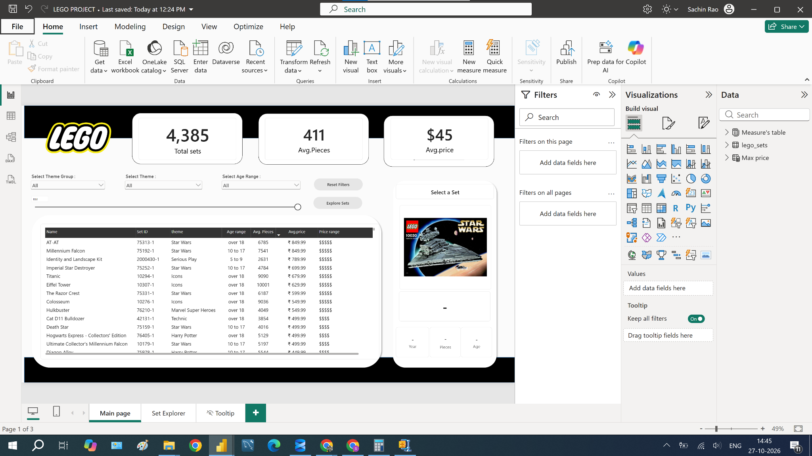
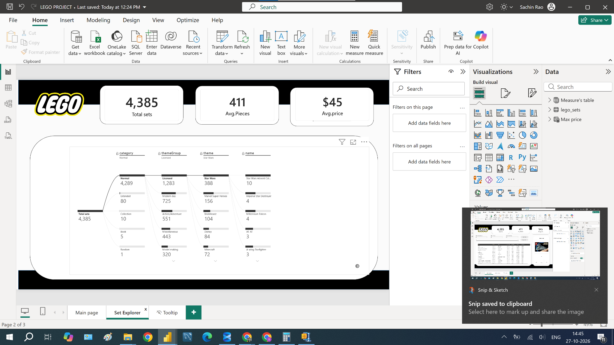

# LEGO Set Explorer | Power BI

I built this Power BI report to make it easier to explore LEGO sets by theme, age recommendation, price and number of pieces. Instead of searching through a long list, I wanted to be able to narrow down the options and look at the details of a particular set in one place.

The report covers **4,385 sets across 100 themes and 15 theme groups**, with release years ranging from **1992 to 2022**. I used Power Query to prepare the data, DAX to create the calculations, and two report pages to move between a detailed set list and a breakdown of the collection.

This project helped me practise how filters, measures and visual interactions work together. I focused on making the report useful for someone comparing sets by their interests, age recommendation or budget.

[Power BI report](Report/LEGO_Set_Explorer.pbix) · [DAX measures](DAX/Measures.dax) · [Data preparation](docs/Data_Preparation.md)

## What I wanted to find out

- Which themes and theme groups have the most sets in the dataset?
- What does a typical set look like in terms of price and piece count?
- How many sets fall into each age and price group?
- Which sets have the most pieces or the highest listed prices?
- How can I make it easy to shortlist sets and inspect their details?

## Report preview

### Main page



### Set Explorer



## How I organised the report

### Main page

I placed three summary cards at the top: total sets, average pieces and average price. Below them, I added dropdown filters for theme group, theme and age range, along with a maximum-price selector for the set table.

The table brings together the set name, set ID, theme, age group, pieces, price and price band. Selecting a set lets me inspect its image and details in the panel on the right. The detail measures show a prompt or a dash when the current selection contains more than one distinct value.

I also added a **Reset Filters** bookmark button and an **Explore Sets** button to move to the second page.

### Set Explorer

I used a decomposition tree to break the total set count down by **category, theme group, theme and set name**. This gives me a way to start with the full collection and follow a particular branch into more detail. A back button returns to the main page.

There is also a hidden tooltip page containing a set-image visual.

## Data preparation

I imported the LEGO CSV into Power Query and prepared it for the report by:

- Setting data types for release year, pieces, minimum age and price.
- Renaming `agerange_min` to `age` and `US_retailPrice` to `Price`.
- Removing the Brickset page link, thumbnail link and minifigure count from the final table.
- Filtering out records without pieces, minimum age, price or an image URL.
- Adding age groups and price bands for filtering and comparison.

The final `lego_sets` table contains one row per set ID. I kept the set ID in the table because different sets can share the same name. The model also includes a separate measures table and a disconnected maximum-price parameter table.

## Main numbers

These figures describe the full cleaned dataset, before selecting a theme or age group.

| Measure | Value |
|---|---:|
| Total sets | 4,385 |
| Themes | 100 |
| Theme groups | 15 |
| Average pieces per set | 410.98 |
| Average listed price | $44.74 |
| Release years represented | 1992–2022 |

The report cards round average pieces to **411** and average price to **$45**. Prices come from the source's US retail price field; they are historical values in this dataset.

## What I found

- **City has the most sets in the cleaned dataset**, with 445, followed by Star Wars with 388 and Duplo with 313.
- **Licensed is the largest theme group**, with 1,288 sets, or about 29.4% of the collection.
- **The 5 to 9 age group contains 3,338 sets**, roughly 76.1% of the dataset. This grouping uses each set's minimum recommended age.
- **2,248 sets are priced below $25**, just over half of all sets. There are only nine sets in the $500-and-above price band.
- **World Map has the highest piece count**, at 11,695 pieces. Eiffel Tower follows with 10,001, and Titanic has 9,090.
- **AT-AT and Millennium Falcon share the highest listed price**, at $849.99 each. World Map has more pieces than either of them, which gave me a useful example of why piece count alone does not explain price.

These findings refer to the records left after cleaning. The data describes LEGO products and their listed attributes; it does not contain sales volumes or customer purchases.

## DAX I used

I used `DISTINCTCOUNT` for the number of sets so that the count is based on set IDs, and `AVERAGE` for price and pieces.

```dax
Total sets = DISTINCTCOUNT(lego_sets[set_id])

Avg.price = AVERAGE(lego_sets[Price])

Avg.Pieces = AVERAGE(lego_sets[pieces])
```

For the detail panel, I used `SELECTEDVALUE` to return a value when the selection resolves to one distinct result.

```dax
Selected Set = SELECTEDVALUE(lego_sets[name], "Select a Set")

Selected pieces = SELECTEDVALUE(lego_sets[pieces], "-")
```

The maximum-price selector uses a separate parameter table. A measure compares the price in the current table-row context with the selected limit, and the set table keeps rows where that measure returns 1.

```dax
Max price Value = SELECTEDVALUE('Max price'[Max price], 850)

Max price filter =
IF([Avg.price] <= 'Max price'[Max price Value], 1, 0)
```

The complete set of measures is in [DAX/Measures.dax](DAX/Measures.dax).

## What I practised

- Cleaning and grouping data in Power Query.
- Choosing the right level of detail: one record per set ID.
- Writing measures that respond to the current selection.
- Using a disconnected parameter for a price filter.
- Building a decomposition tree and image-based detail panel.
- Adding bookmarks, navigation buttons and slicers to a report.

## Open the report

Download [LEGO_Set_Explorer.pbix](Report/LEGO_Set_Explorer.pbix) and open it in Power BI Desktop. The file includes the imported data, so the saved report can be explored without refreshing the CSV first.

The original CSV is not included in this repository. Refreshing the data requires `lego_sets.csv` and an updated source path in Power Query. The set images use external URLs and need an internet connection.

## Files in this repository

| Folder or file | Contents |
|---|---|
| `Report/` | Power BI report |
| `Screenshots/` | Main page and Set Explorer screenshots |
| `DAX/` | Measures and parameter-table expression |
| `Power_Query/` | Data preparation query |
| `Data/README.md` | Source-file and refresh details |
| `docs/` | Data dictionary, preparation steps and report notes |

## What I would improve next

I would make the currency formatting consistent across the cards and table, add a price-per-piece comparison, and include a release-year filter. I would also make the budget selection apply consistently to the summary cards so that the displayed totals match the shortlisted sets.
